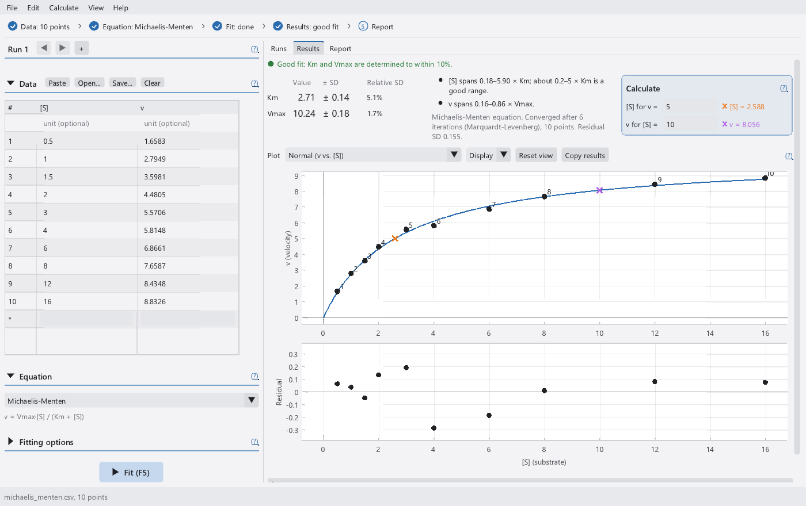
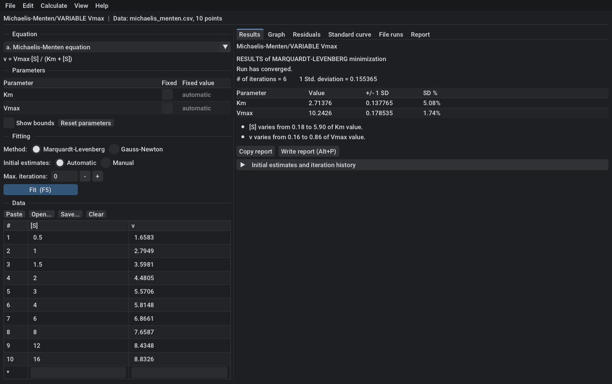
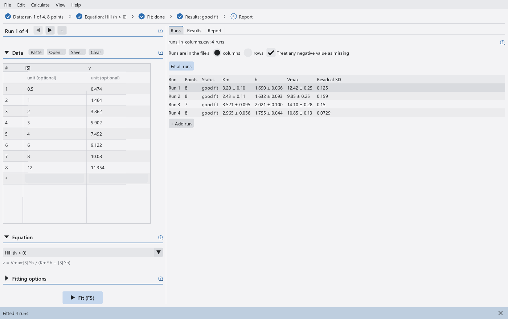
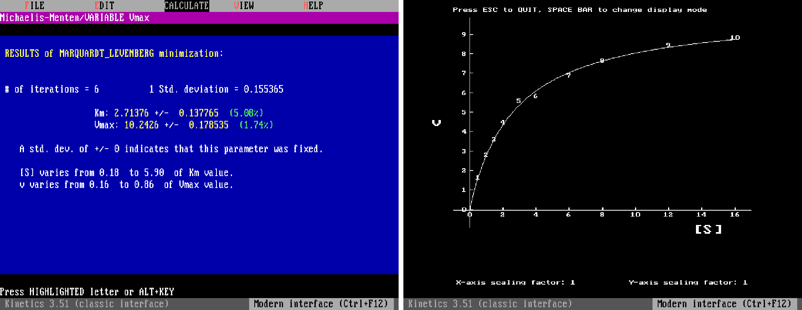

# Kinetics

A modern re-implementation of **Steve Brooks's kinetics program**, *SB's Kinetics Program* 3.51, for **non-linear curve fitting of enzyme kinetics data**. The original MS-DOS program is described in:

> Brooks, S. P. (1992). A simple computer program with statistical tests for the analysis of enzyme kinetics. *BioTechniques* 13(6), 906–911. [Europe PMC](https://europepmc.org/article/med/1476744)

Kinetics is available **on the desktop** and **on the web via WebAssembly**, both built from the same C++20 code.

**Try it in your browser: <https://efedo.github.io/kinetics/>**. Nothing to install; it runs entirely in the page, and your data stays on your computer.

The original was written in 16-bit Borland C++. This version uses **SDL3** for the window and **Dear ImGui + ImPlot** for the interface and graphs. Built natively it is a Windows (or other desktop) program; built with Emscripten it is a **WebAssembly** page that runs in a browser.



## What it does

- **Fits 11 equations** by non-linear least squares, with the Marquardt–Levenberg or Gauss–Newton method:
  - Michaelis–Menten
  - Hill (h > 0, or h ≥ 1)
  - three activator equations
  - linear inhibition, and non-linear inhibition giving I50 or K50
  - Arrhenius (temperature curves)
  - linear regression
- **Reports each parameter with its standard deviation and tests the fit.** The residuals get a runs test and a sign test, any beyond 2 SD are flagged, and slopes and Hill coefficients are tested.
- **Plots the data and fitted curve ten ways:** normal, double-reciprocal (Lineweaver–Burk), Hanes–Woolf, Eadie–Hofstee, Hill, log-log, saturation, Job plot, Arrhenius and residuals.
- **Uses the fitted curve as a standard curve**, reading off X for a measured Y or Y for a given X.
- **Fits files of many runs**, from spreadsheet files or MPA microplate files, one run at a time or all at once.
- **Writes reports** in three lengths, as plain text or comma-separated for spreadsheets.

## How to use it

1. **Choose an equation** from the list at the top left.
2. **Enter your data.** Type concentration and velocity pairs into the table, paste two columns from a spreadsheet, or open a CSV file. To try it out, use Try an example on the getting-started page, or File > Open example.
3. **Press Fit (F5).**
   - The Results tab shows the parameters and the test results.
   - The Graph tab shows the fit in any of the plot types.
   - The Residuals tab lists each point's deviation from the curve.
4. **Keep the results.** Write report (Alt+P) adds a report to a text file, and Copy report puts it on the clipboard.

For a file with many runs, import it from the File menu, then fit one run or all of them on the File runs tab. The Help menu covers each step in more detail. The theme follows the system's light or dark setting unless you choose one under View > Theme, and View > Text size (Ctrl+= and Ctrl+-) makes the text larger or smaller.

To use the original 1992 interface instead, choose View > Classic interface or press Ctrl+F12 (see [Classic interface](#classic-interface)).

<p>
  
  
</p>

*Left: results of a Michaelis–Menten fit. Right: four runs from a spreadsheet file, all fitted with the Hill equation, in the light theme.*

## Classic interface



Kinetics can also show the original v3.51 interface, reproduced exactly: its text-mode screens, menus, colours, wording and keys, and its plots in VGA graphics. It runs in the same window on the desktop and in the browser, and doesn't use ImGui.

- **Switching.** Choose View > Classic interface, or press Ctrl+F12. To come back, click *Modern interface* in the bar under the screen, or press Ctrl+F12 again. To start in it, use `--classic` (or `?classic` in the web address).
- **One session.** Both interfaces work on the same equation, settings, data, imported file, results and report options, so switching shows the same work and changes made in one appear in the other. The classic interface reopens at its main menu each time.
- **Same calculations.** The classic screens use the same corrected core as the modern interface, so their results are identical. They show them in v3.51's formats. The plots draw the core's points and curves, so a fitted curve can sit a pixel away from v3.51's, and the core's fixes show (for example, the log-log extrapolation).
- **Differences from the original.** The screens and keys are otherwise unchanged.
  - The data grid holds up to 500 pairs (v3.51: 50).
  - There is no printer. Output sent to PRINTER is appended to `PRINTOUT.PRN` in the report folder, or downloaded in the browser.
  - In the browser, the file list shows the page's own files, including the examples, plus an *Upload from your computer* entry.
  - Alt+Q quits on the desktop, as it did in DOS. In the browser it restarts the program.
  - Behaviour that would crash or lose data is fixed. For example, Esc at "Overwrite existing file ?" now cancels instead of overwriting, and Esc in the data grid's *KEEP/START* window now keeps the data (v3.51 emptied the table).
  - Odd but harmless behaviour is kept. For example, the Calculate menu reads "-atlY".
- **How it works.** `source/remake/classic` emulates the PC that v3.51 ran on: 80×25 text-mode video memory, the Borland console functions, the keyboard as `getch()` saw it, and the subset of Borland's BGI graphics the plots used (VGA, 640×480, as the program drew them on a VGA PC). The program is ported from the original source file by file. C++20 coroutines stand in for its blocking keyboard reads, so the same code runs in the desktop event loop and in the browser.
- **Checked against the original.** The screens were compared with the original v3.51 executable running in DOSBox, driven by the same keys. The plots' axes, labels and text match it pixel for pixel. The menus, results, help pages, residual table and file list match its layout, colours and scrolling keys.
- **Fonts.** The screens use the IBM VGA 9×16 and BIOS 8×8 fonts from VileR's [Ultimate Oldschool PC Font Pack](https://int10h.org/oldschool-pc-fonts/), under CC BY-SA 4.0 (see [the font notice](source/remake/classic/fonts/LICENSE.md)). Plot text uses Borland's BGI font as the drivers draw it: their own glyphs for A–z, taken from Borland's `CGA.BGI` driver, and the BIOS font for the rest.

## Status

| | |
|---|---|
| **Functionality** | Everything the DOS program did is ported: all 11 equations; Marquardt–Levenberg and Gauss–Newton fitting with bounds and fixed parameters; automatic or manual initial estimates; the statistics and residual tests; all 10 plot types; spreadsheet and MPA file import; fitting every run of a file; using the curve as a standard curve; SHORT/MEDIUM/LONG reports; and the help text, rewritten for the new interface. |
| **Defects** | The 12 defects found in v3.51, plus several found while porting, are fixed (see [Changes from v3.51](#changes-from-v351)). |
| **Tests** | `kinetics_tests`: 198 test cases and about 34,500 checks, one file per core module plus a validation file. They cover every equation's values, derivatives and inverses, both fitting methods with bounds and fixed parameters, the statistics against exact values, every plot transform, file parsing, batch analysis and reports, and a regression test for each defect fixed. The tests reach **100% of the core library's lines and 95% of its branches** (see [Test coverage](#test-coverage)). They also refit published datasets (see [Validation](#validation-against-published-analyses)). All pass natively and compiled to WebAssembly under Node.js. |
| **Verified (desktop)** | Built with MSVC 19.51 (Visual Studio 2026) at `/W4` with no warnings. Each tab and dialog was rendered with `--screenshot` and checked, and report files were written through the app. |
| **Verified (web)** | Built with Emscripten 6.0.13 and driven in headless Microsoft Edge with real mouse and keyboard events. Typing data into the table, fitting with F5, writing a report (downloaded as `results.txt`), the File menu, and opening a file through the browser's file picker all work, with the same results as the desktop build. |
| **Not yet verified** | Hand use of the native desktop file dialogs. In the browser: pasting from the system clipboard, and browsers other than Edge/Chromium. Desktop builds on Linux and macOS: the code is portable SDL3/C++20, but only Windows has been built. |

## Building

You need CMake 3.24 or later and a C++20 compiler. The first configure downloads SDL 3.4.18, Dear ImGui 1.92.8 and ImPlot 1.0 (pinned by SHA-256), so it needs internet access.

```bash
cmake --preset x64-release
cmake --build --preset x64-release
ctest --preset x64-release
```

On Windows, run these from a *Developer PowerShell for VS* prompt, or open the folder in Visual Studio, which picks up `CMakePresets.json`. The result is `out/build/x64-release/Kinetics.exe`. SDL is linked statically, so it is a single executable, with an `examples/` folder copied next to it.

To build and test only the core library, without SDL or ImGui (no download needed):

```bash
cmake --preset core-only
cmake --build --preset core-only
ctest --preset core-only
```

### WebAssembly build

You need the [Emscripten SDK](https://emscripten.org/docs/getting_started/downloads.html) (built and tested with 6.0.13) and Ninja. Load the SDK's environment first, so that `EMSDK` is set; `ctest` runs the core tests under the SDK's Node.js.

```bash
emsdk_env
cmake --preset wasm-release
cmake --build --preset wasm-release
ctest --preset wasm-release
```

### Test coverage

Line and branch coverage of the core library comes from an instrumented WebAssembly build of the tests (gcov format, read with the `llvm-cov` that comes with the Emscripten SDK). MSVC has no equivalent, so this is how coverage is measured on Windows too.

```bash
cmake --preset wasm-coverage
cmake --build --preset wasm-coverage
python tools/coverage.py --run --details
```

`--run` clears old counters and runs the tests; `--details` lists every uncovered line and untaken branch. To build only some test files while working on them, configure with, for example, `-DKINETICS_TEST_GLOBS="tests/main.cpp;tests/test_fit.cpp"`.

On Windows, `emsdk_env` is `emsdk_env.bat` in the SDK folder. Ninja comes with Visual Studio's CMake tools, or install it separately. The result is three files in `out/build/wasm-release`: `index.html`, `index.js` and `index.wasm` (about 2.2 MB in total; the example data and fonts are embedded). Serve that folder from any static web server, for example:

```bash
python -m http.server 8765 --directory out/build/wasm-release
```

Then open <http://localhost:8765>. Browsers will not load WebAssembly from a `file://` URL, so it must be served.

**GitHub Pages.** Every push to `main` builds the web version with the same Emscripten version, runs the core tests under Node.js, and publishes the page at <https://efedo.github.io/kinetics/> ([.github/workflows/pages.yml](.github/workflows/pages.yml)). It can also be run by hand from the Actions tab.

**Differences in the browser.**
- **Files:** files are opened with the browser's file picker. Saved tables and reports are downloaded; each time a report is written, the whole report file collected so far is downloaded again. Nothing but the preferences is kept after the page closes. Preferences are stored in the browser's local storage.
- **Clipboard:** "Paste data" asks the browser for clipboard access. Ctrl+V inside a cell pastes text copied in the app, or text from the clipboard once access has been granted.
- **Shortcuts:** F5, Ctrl+O and Ctrl+S go to the app rather than the browser. Some Alt shortcuts may be taken by the browser while a text field is being edited, for example Alt+D in Chrome and Edge.
- **Quit:** there is no Quit item; close the tab.
- **URL parameters:** these act like the desktop command line. For example, `index.html?model=a&open=/examples/michaelis_menten.csv&fit&tab=graph&plot=2` opens the Michaelis–Menten example, fits it and shows the Lineweaver–Burk plot.

## Interface reference

The window keeps the original menu structure (File, Edit, Calculate, View, Help) and its Alt-key shortcuts.

- **Left panel:** the equation, the data table, the Fit button, and the folded Fitting options (the parameter table with its Fixed check boxes, values and optional bounds; the minimization method; initial estimates; the iteration limit). The Fitting options open by themselves when a setting differs from the default or a fit does not converge, and show a one-line summary when folded. Type in the last row of the data table to add points, right-click a row number to insert or delete a row, or paste two columns from a spreadsheet.
- **Right panel:** a getting-started page until there is something to show, then tabs: Results, Graph, Residuals, Standard curve and Report after a fit, and File runs after a file is imported (its close button, or File > Close imported file, puts the file away). The Results tab rounds each value to the precision of its standard deviation (Km = 2.71 ± 0.14) and shows all the digits in a tooltip; reports keep every digit. When the data or settings change after a fit, the results are greyed out under a note until you fit again.
- **Labels and shortcuts:** labels come before the fields they name, and keyboard shortcuts are listed in the menus and in each button's tooltip rather than on the buttons. Fit (F5) with an empty table puts the cursor in the table with a note saying what to enter.

| Key | Action | Key | Action |
|---|---|---|---|
| F5 / Alt+R | Fit the table data | Alt+L | Results |
| Alt+S | Fit the selected file run | Alt+G | Graph |
| Alt+A | Analyse all runs of the imported file | Alt+I | Residuals |
| Alt+W | File runs (step through results) | Alt+X / Alt+Y | Standard curve: new X / new Y |
| Alt+T | Equation list | Alt+O | Report options |
| Alt+D | Data table | Alt+P | Write report |
| Alt+M | Load the imported run into the table | Alt+H / F1 | Help |
| Ctrl+O / Ctrl+S | Open / save the data table | Alt+Q | Quit (desktop) |
| Ctrl+= / Ctrl+- | Larger / smaller text | Ctrl+0 | Normal text size |

**Example data** is in [`examples/`](examples/), and can also be opened from File > Open example:

| File | Contents |
|---|---|
| `michaelis_menten.csv` | Michaelis–Menten data table |
| `arrhenius.csv` | Arrhenius data table |
| `spreadsheet_runs.txt` | Spreadsheet file with four runs for the Hill equation, one with a missing value |
| `mpa_plate.txt` | MPA file with two inhibition datasets; it needs the [I] values 0, 0.5, 1, 2, 4, 8, 16, 32 in the table |

**File formats.**
- *Data tables:* two columns, separated by commas, semicolons, tabs or spaces; heading lines are skipped.
- *Spreadsheet and MPA files:* the v3.51 formats, described under Help > Using file data.
- *Reports:* text files, appended run after run. SHORT and MEDIUM reports can be comma-separated for spreadsheets.

**Preferences** (report options, method, theme, text size, last folder) are saved in `kinetics.ini` in the per-user application data folder (`%APPDATA%\Kinetics` on Windows). Preferences saved by earlier versions in `%APPDATA%\SB\Kinetics` are moved there on the first start. This file replaces `INPUT.DAT` and `OUTPUT.DAT`.

**Command line (desktop).** All options are optional. They are useful for scripting and for producing screenshots. The web build accepts the same options as URL parameters.

```bash
Kinetics --model b --import examples/spreadsheet_runs.txt --analyse-all --report results.txt
```

- `--open <table>`: open a data table
- `--import <file>`, `--import-mpa <file>`: import a spreadsheet or MPA file
- `--model <a-k>`: choose the equation by its v3.51 menu letter
- `--fit`: fit the table data
- `--analyse-all`: fit every run of the imported file
- `--report <file>`: append reports to the file
- `--tab <name>`, `--plot <1-10>`, `--show help|about|report-options|fit-options`: choose the view
- `--theme system|dark|light`: colour theme (also under View > Theme; by default the same as the system)
- `--text-size <80-150>`: text size in percent (also under View > Text size; 100 by default)
- `--classic`: start in the classic interface; `--classic-keys "alt+g,n"` also types those keys into it (for screenshots: text and key names such as `enter`, `esc`, `up`, `f1`, `alt+x`)
- `--size <W>x<H>`: window size
- `--screenshot <file.bmp>`: render off-screen, save the image and exit

## Project layout

```
CMakeLists.txt, CMakePresets.json   build (cmake/Dependencies.cmake fetches SDL3, ImGui, ImPlot)
source/remake/core/     fitting library, no GUI dependencies
  models                the 11 equations: values, analytic derivatives, inverses, default bounds
  fit, linalg           Marquardt-Levenberg and Gauss-Newton with bounds and fixed parameters
  guess                 automatic initial estimates
  stats                 t and F probabilities, linear regression with lack of fit, runs and sign tests
  analysis              one complete analysis: validation, fit, statistics, interpretation text
  batch                 fitting every run of an imported file
  plots                 the 10 plot transforms and the fitted curve in plot coordinates
  import                spreadsheet, MPA and two-column table files
  report                SHORT / MEDIUM / LONG reports
  settings              kinetics.ini
source/remake/app/      SDL3 + Dear ImGui application (main loop, panels, dialogs, help text)
source/remake/classic/  the classic interface: an emulated text-mode PC and BGI graphics,
                        and the original program ported onto it (edit, cd, file, view)
  platform              what differs between desktop and browser: file dialogs, downloads,
                        clipboard, stored preferences
web/shell.html          the page that hosts the WebAssembly build
tests/                  core library tests (check.hpp harness, one file per module)
tools/coverage.py       line and branch coverage summary for the core library
examples/               example data files
docs/                   screenshots
```

## Validation against published analyses

`tests/test_validation.cpp` refits published datasets and compares the results with the published numbers, to the precision they were printed with.

| Dataset | Equation | Result |
|---|---|---|
| Puromycin, treated and untreated (Treloar 1974; Bates & Watts 1988, the standard non-linear regression example) | Michaelis–Menten | Vmax, Km, their standard errors and the residual SD match to every printed digit, with both fitting methods. |
| NIST StRD "NoInt1" and "NoInt2" | Linear regression through the origin | Slope, its SD and the residual SD match the certified values to 12 significant digits. |
| NIST StRD "Norris" | Linear regression | The intercept, slope, their SDs, the residual SD, R² and the ANOVA match the certified values to 9 digits or better. |
| Bell, Smith & Storey 2014, *PeerJ* 2:e634: GAPDH from hibernating ground squirrels (Storey lab, which used this program) | Arrhenius | Long-torpor enzyme: fitting each preparation in the paper's supplementary data gives a mean Ea of 53.99 kJ/mol; the paper reports 54 ± 2. |

- **Bell et al. controls.** For the euthermic-control GAPDH, the paper's Ea of 28 ± 2 kJ/mol can't be reproduced from its own supplementary rates: any straightforward fit gives about 33.6. The test checks only that the fits agree with an independent calculation.
- **Citing papers.** The original paper (Brooks 1992) has about 220 citing papers. The open-access ones, and those whose full text could be read, report only the fitted parameters (Km, I50 and so on, as mean ± SEM), with the curves shown in figures. None prints the raw data in a table, so none could be re-run except Bell et al., whose raw rates are in a supplementary spreadsheet.

## Changes from v3.51

**Defects fixed.** These 12 were found by reading the v3.51 source.

| # | Fix |
|---|---|
| 1 | Analysing all runs no longer skips every other run when reports use sequential numbering. Report numbering has its own counter. |
| 2 | Every fit uses its own data's velocity range, including a single run fitted from a file. |
| 3 | "Starting # for numbering" is used. |
| 4 | The slope is tested against 0 (what v3.51 computed) and against 1 (what its message said), and both are reported. The regression F test and, with replicated X, the lack-of-fit F test are also shown. |
| 5 | Marquardt–Levenberg stops on a relative change in χ² or a negligible step, and has an iteration limit (200 by default). |
| 6 | Gauss–Newton clamps the correct parameter at its bound. |
| 7, 8 | Preferences are a text file; no `FILE*` pointers are stored or reused. |
| 9 | Labels are built per equation, never by editing string literals. |
| 10 | Memory is managed by standard containers. |
| 11 | The Arrhenius initial estimate is a straight-line fit of log10(v) against 1/T. v3.51 took logarithms of data that were already log10(v). |
| 12 | Menu and help wording corrected; unused declarations dropped. |

**Other defects found while porting.**
- The Arrhenius derivative used 2.3036 instead of ln 10, and the gas constant differed between routines.
- Gauss–Newton reported the line-search count of its last iteration as "# of iterations".
- The Hill and log-log plot extrapolations transformed the intercept twice.
- The runs test gave wrong probabilities for some sequences (n choose r with r > n was not 0).
- Two distinct X values with replicates used an arbitrary residual mean square of 1e5.
- Linear regression flagged "> 2 S.D." residuals using a stale SD from the last non-linear fit.
- The derivatives substituted a tiny X for X ≤ 0 for every equation, which distorted Arrhenius fits below 0 °C.

**Defects found by the test suite.** Each now has a regression test.
- When a parameter reached one of its bounds, both fitting methods clamped the whole step, so a fit could stop short of the true constrained minimum. A Hill fit with h ≥ 1 on data that want h < 1 is an example. v3.51 clamped the same way. Now a parameter at a bound is held there while the others keep moving.
- The normal equations are now scaled to a unit diagonal before solving, as in Marquardt's own formulation. Without this, parameters in very different units, such as Km = 10⁻⁴ M with Vmax = 10⁴, looked singular.
- A perfect fit (residual SD 0) flagged every point as beyond 2 SD, as v3.51 did.
- A slope or intercept of exactly 0 with an SD of 0 was reported as significant, because 0/0 was treated as an infinite t.
- The Arrhenius standard curve returned a temperature below absolute zero for rates above log10(A).
- Smaller cases:
  - a matrix inverse that overflowed was reported as valid
  - a huge column count or run number in a spreadsheet file overflowed
  - automatic estimates for empty data ignored the parameter bounds

**Deliberate changes.**
- *Linear regression with replicated X values:* the standard deviations and the t and F tests use the ordinary residual mean square (df = n − 2), as NIST's certified values and statistics packages do. When X values were repeated, v3.51 used the deviations-from-regression mean square instead: the scatter of the group means about the line, df = groups − 2, after Sokal & Rohlf. That gives different SDs, about 1.4% larger for the NIST Norris data. The lack-of-fit F test, which compares that scatter with the scatter within groups, is still reported.
- *Precision and constants:* calculations are in double precision. Temperatures use 273.15 K, and R = 1.98720 cal mol⁻¹ K⁻¹. The log10(A) bounds allow negative values. Gauss–Newton tests convergence for each parameter.
- *Estimates and fixed parameters:*
  - A fixed v0 is the *mean* velocity at [A] = 0 or [I] = 0.
  - The automatic estimate for the non-linear I50 equation accounts for its (1 − 2·vmin/v0) factor.
  - Any parameter except the Arrhenius ones and the linear slope can be fixed.
  - Bounds are editable.
- *Data and files:*
  - There is no 50-point limit, and the limits of 20 MPA datasets and 30 velocities are gone.
  - In spreadsheet files, treating every negative value as missing can be switched off, so that only −1 counts as missing.
- *Reports:*
  - SHORT and MEDIUM list only the equation's parameters (plus Ea in kJ/mol for Arrhenius).
  - LONG adds the convergence message and iteration count.
  - Reports go to files with normal line endings instead of LPT1. Form feeds are replaced by a separator line.
- *Interface:*
  - The DOS file browser is replaced by native dialogs, and `DATE.DAT` by the system date.
  - Automatic preview is replaced by stepping through the results of all runs.
  - The fit's iteration history is shown.

**Not ported.** These routines in v3.51 were never called by the program:
- Runge–Kutta integration
- the cubic and quadratic solvers
- the non-linear system solver and numerical derivative matrix
- the random number generator
- the Tukey and Dunnett table readers (`qtable.dat` / `qptable.dat`)

## AI assistance

This re-implementation was built with substantial help from an AI model, **Claude Opus 5.5** by Anthropic, working in Claude Code. Eric Fedosejevs directed the work and made the decisions on scope, design and the interface.

Claude:
- read the original v3.51 source and listed the defects it found;
- migrated the code from 16-bit Borland C++ to C++20 with SDL3, Dear ImGui and ImPlot, fixing those defects on the way;
- built the interface, including the dark and light themes, and added the WebAssembly build;
- built the classic interface: the emulated PC and the port of the original screens onto it;
- wrote the test suite in [`tests/`](tests/), which covers every line of the core library, and the coverage tooling; searched the papers citing the original for data to re-run, and validated the fits against published analyses; fixed the defects the tests found;
- did the testing: running the tests natively and under Node.js, rendering every screen, and driving the web build in a headless browser.

The fitting code is checked against known values in the tests. Even so, AI-written code can contain mistakes that the tests miss, so check results that matter against another method.

## License

Kinetics is released under the [MIT License](LICENSE). The original *SB's Kinetics Program* 3.51 is copyright Steve Brooks. The font data in [`source/remake/classic/fonts/`](source/remake/classic/fonts/) is VileR's, under CC BY-SA 4.0.
